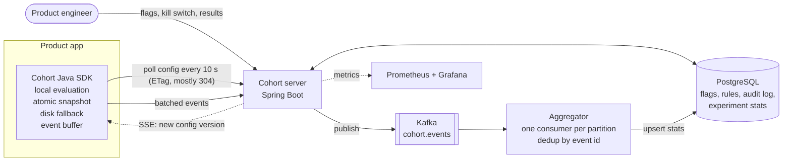

# Cohort

A feature flag and A/B experimentation service in Java. Product teams create a flag, roll it out
to a percentage of users, run an experiment, and read which variant won.

Flags are evaluated **inside the product app** by a Java SDK, so a flag check is a hash and a loop
(about 230 ns), never a network call. If the Cohort server goes down, apps keep serving the last
config they had.



## Quick start

Needs Docker and JDK 21+.

```sh
docker compose up -d --build          # Postgres, Kafka, server, Prometheus, Grafana
mvn -pl cohort-simulator -am install -DskipTests
mvn -pl cohort-simulator exec:java    # 100,000 simulated users through the real SDK
```

The simulator creates a `new-search-ranking` experiment, sends traffic with control converting at
10% and treatment at 11%, and prints the results (cumulative; this is after two runs):

```
variant         exposures  conversions       rate       lift      p-value       seq. p
control           100,128        9,987      9.97%          -            -            -
treatment          99,872       10,912     10.93%      +9.5%     3.50e-12     3.54e-10
```

| URL | What |
|---|---|
| http://localhost:8080 | Admin console: flags, kill switch, results, audit log |
| http://localhost:8080/swagger-ui.html | REST API docs |
| http://localhost:3000 | Grafana dashboard (anonymous viewer) |
| http://localhost:9090 | Prometheus |

Dev API keys are `dev-admin-key` (admin API) and `dev-sdk-key` (SDK API); override them with
`COHORT_ADMIN_KEY` and `COHORT_SDK_KEY`.

## Using the SDK

```java
CohortClient cohort = CohortClient.builder()
    .serverUrl("http://localhost:8080")
    .apiKey(System.getenv("COHORT_KEY"))
    .pollInterval(Duration.ofSeconds(10))
    .streaming(true)                     // optional: SSE push, so a kill switch lands in under a second
    .build();

CohortUser user = CohortUser.of("user-123").with("country", "IN");
String variant = cohort.getVariant("new-search-ranking", user);   // "control" or "treatment"
boolean on = cohort.isEnabled("dark-mode", user, false);           // false = fallback default
cohort.track("new-search-ranking", user, "applied_to_job");        // conversion event

new CohortMetrics(cohort).bindTo(meterRegistry);                   // optional Micrometer metrics
```

## Modules

| Module | What it is |
|---|---|
| `cohort-common` | Flag model, MurmurHash3 bucketing, rule evaluator and validator, shared by server and SDK |
| `cohort-server` | Spring Boot service: admin API, SDK config API, event ingest, aggregator, results |
| `cohort-sdk` | Java client: local evaluation, ETag polling, disk snapshot, buffered events |
| `cohort-simulator` | Generates experiment traffic through the real SDK |
| `cohort-bench` | JMH micro-benchmarks of flag evaluation |

## API

**Admin** (`X-API-Key: <admin key>`, optional `X-Actor` for the audit log)

| Method and path | What it does |
|---|---|
| `POST /api/v1/flags` | Create a flag with variants and rules |
| `GET /api/v1/flags`, `GET /api/v1/flags/{key}` | List / read flags |
| `PUT /api/v1/flags/{key}` | Replace a flag; must send the `version` it read, 409 if stale |
| `POST /api/v1/flags/{key}/kill` | Kill switch: off for everyone on the next SDK poll |
| `DELETE /api/v1/flags/{key}` | Archive; drops out of the SDK config |
| `GET /api/v1/flags/{key}/audit` | Who changed what, when, with before and after |
| `GET /api/v1/experiments/{key}/results` | Per-variant exposures, conversions, rate, lift, fixed and sequential p-values |

**SDK** (`X-API-Key: <sdk key>`)

| Method and path | What it does |
|---|---|
| `GET /sdk/v1/config` | Full config; `If-None-Match` with the version ETag returns 304 |
| `GET /sdk/v1/stream` | Server-sent events: the config version on connect and after every change |
| `POST /sdk/v1/events` | Up to 500 exposure and conversion events |
| `POST /sdk/v1/evaluate` | Server-side evaluation for clients that cannot run the SDK |

A flag:

```json
{
  "key": "new-search-ranking",
  "defaultVariant": "control",
  "variants": [{"name": "control", "weight": 5000}, {"name": "treatment", "weight": 5000}],
  "rules": [
    {"priority": 1, "type": "ALLOWLIST", "condition": {"userIds": ["qa-1"]}, "variant": "treatment"},
    {"priority": 2, "type": "ATTRIBUTE", "condition": {"attribute": "country", "values": ["IN"]}, "variant": null},
    {"priority": 3, "type": "PERCENT", "condition": {"basisPoints": 1000}, "variant": null}
  ],
  "layer": {"name": "search", "start": 0, "end": 5000}
}
```

Rules run in priority order and the first match wins. A rule with a `variant` serves that variant;
a rule with `"variant": null` serves the weighted split and puts the user in the experiment. Users
no rule matches get `defaultVariant`. Weights are basis points and must sum to 10000.

`layer` is optional. Flags in the same layer must claim non-overlapping slices of its 10000
buckets (the API returns 409 otherwise), and no user is ever in two of their experiments. Users
outside a flag's slice get `defaultVariant` with reason `LAYER_EXCLUDED`; allowlist rules still
reach them, so QA can see every variant.

## Design decisions

**Hash, don't store.** A user's variant is `murmur3_32(salt + ":" + userId) mod 10000`, then a walk
over the cumulative weights. It is a pure function, so any SDK instance gets the same answer with no
database and no shared state, and assignment stays sticky for free.

**Per-flag salt.** Without it, the same users land in treatment of every experiment and experiments
contaminate each other. A test checks two flags overlap on about 25% of users, not 50%.

**Separate rollout and split hashes.** A `PERCENT` rule hashes `salt:rollout` while the split hashes
`salt`. With one hash, a 10% rollout (buckets 0–999) of a 50/50 split would put everyone in control.

**Ramping only adds users.** Going from 10% to 20% adds buckets 1000–1999; nobody already in flips
out. Tested.

**Only split assignments are exposures.** Allowlisted QA users and default-served users never count
toward results.

**Fail safe, in order:** in-memory snapshot, then the disk snapshot if the SDK starts while the
server is down, then the caller's default. A flag check never throws. The chaos tests stop the
server mid-run and restart the SDK offline.

**Atomic snapshots.** Config lives in an `AtomicReference<FlagConfig>` holding an immutable record.
Readers never lock; the poller swaps in a whole new snapshot. Older versions are ignored, so a lagging
server instance cannot roll an SDK back.

**Polling with ETag, push as a hint.** Polling is simple, survives proxies, and when nothing changed a
poll is a 304 with an empty body. SDKs that opt in also hold an SSE connection that carries only the
new version number; on hearing one they fetch the config the normal way. A dropped stream or a missed
message only means the change arrives on the next poll, so push adds speed without adding a second
source of truth. Each connection gets the current version on connect, so a reconnecting SDK catches
up at once, and a 15 s heartbeat both keeps proxies from cutting idle streams and picks up changes
made through other server instances.

**Layers for mutually exclusive experiments.** Flags in a layer bucket users by the layer name rather
than their own salt, so they all agree on every user's layer bucket and disjoint slices mean disjoint
users. Within a slice, the split still uses the flag's salt, so the split stays even. The overlap check
reads other flags, so it runs under the same config version row lock every write already takes.

**Sequential p-values for peeking.** The fixed-sample z-test is only valid if read once, at a sample
size chosen up front; checking it daily and stopping at the first p < 0.05 inflates false positives.
Results also carry an mSPRT always-valid p-value (normal mixture, τ = 1 percentage point), which may
be checked as often as you like. In a simulated A/A test peeked at 20 times, the z-test calls a winner
in over 10% of runs and the sequential test in under 5%.

**Analytics never slow the app.** Events go into a bounded queue flushed by a virtual thread every
5 s or at 500 events. A full queue drops and counts; it never blocks.

**Exactly-once counts from at-least-once delivery.** Every event has a UUID; `seen_events` has it as
primary key, so SDK retries and Kafka redeliveries are no-ops. A user counts once per flag, in the
variant of their first exposure, and converts at most once. Offsets commit only after the database
transaction, so a crash replays rather than loses.

**Set-based aggregation.** Each batch is a few statements over `unnest()` arrays plus one upsert
per (flag, variant), not three round trips per event. The aggregator runs one consumer per partition
(`COHORT_AGGREGATOR_CONSUMERS`, default 6). Events are keyed by flag and user, so one user's events
stay in order on one consumer, and stats deltas are applied in key order so consumers cannot deadlock.

**Optimistic locking at the API.** Updates carry the `version` the client read; a stale one gets 409.
The server takes a row lock (`SELECT ... FOR UPDATE`) so check-and-increment is atomic: in a test,
eight concurrent writers from the same version produce exactly one 200 and seven 409s.

**One transaction per change.** The flag write, its audit row and the global `config_version` bump
commit together, then the server's Caffeine config cache is rebuilt, so `/sdk/v1/config` never hits
Postgres per request.

## Testing

```sh
mvn verify     # unit tests + Testcontainers integration tests (needs Docker)
```

- Evaluator: rule order, allowlist, attributes, weights, ramp stability, a 1,000,000-user
  distribution test (each side of 50/50 within 0.5%), and layers: 100,000 users across two flags
  in one layer with none in both.
- SDK: ETag polling, kill switch propagation, server outage, offline restart from disk, buffer
  overflow, batching, SSE push with polling effectively off, and stream reconnect after an outage.
  Uses an in-process fake server.
- Server (Testcontainers Postgres and Kafka): CRUD, validation, stale and concurrent writes, audit,
  layer overlap, ETag/304, the SSE stream, dedup of retried events, first-exposure attribution,
  orphan conversions.
- `TwoProportionZTest` against known values; `SequentialTest` against simulated peeking A/A tests.

## Numbers

From [docs/BENCHMARKS.md](docs/BENCHMARKS.md), measured on one laptop:

| What | Result |
|---|---|
| SDK `getVariant` (JMH) | 233 ns average, 0.8 µs p99 |
| Config polling (k6, 50 VUs) | 23,650 req/s, p95 4.5 ms, 0 errors |
| Event ingest (k6, 500-event batches) | 55,800 events/s, 0 errors |
| Aggregation (one consumer) | 9,250 events/s |

## What's next

Per-user auth for the admin API and console in place of a shared key; multiple metrics per
experiment; CUPED variance reduction; pushing changes between server instances (Postgres
`LISTEN/NOTIFY`) so streams on every instance fire at once, not on the next cache expiry.
